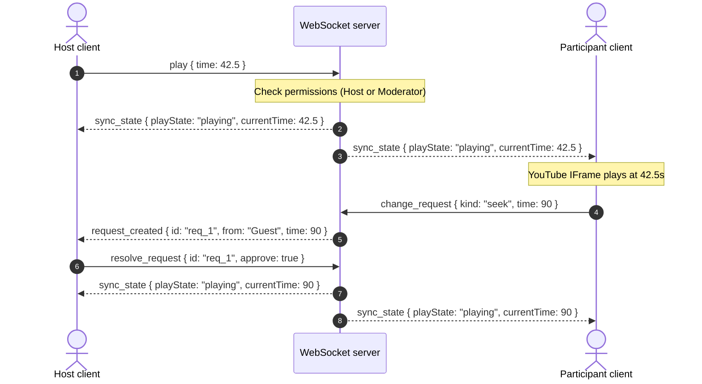

# PartyWatch

Real-time synchronized YouTube watch parties with role-based access control.

PartyWatch lets a group watch the same YouTube video at the same moment. A host creates a room, shares the room code, and playback stays aligned for everyone in it: play, pause, seek and video changes are applied to every participant together.

## Contents

- [Features](#features)
- [Roles and permissions](#roles-and-permissions)
- [Architecture](#architecture)
- [WebSocket protocol](#websocket-protocol)
- [Tech stack](#tech-stack)
- [Getting started](#getting-started)
- [Deployment](#deployment)
- [License](#license)

## Features

- **Synchronized playback.** Play, pause, seek and video changes are applied across all connected clients.
- **Role-based access control.** Separate permissions for Host, Moderator and Participant keep playback orderly.
- **Change request approvals.** Participants can request a seek, pause or video change. Hosts and Moderators approve or decline each request from an in-room notification.
- **Presence notifications.** Lightweight join and leave notices, with a 3.5 second reconnect debounce so a page reload does not trigger repeated notifications.
- **Chat and reactions.** In-room chat with markdown support, plus floating emoji reactions.
- **Session persistence.** Dual-token JWT authentication with silent refresh and a 60 second rotation grace window.
- **Responsive interface.** Dark theme built with Tailwind CSS v4 and Framer Motion, designed for desktop and mobile.

## Roles and permissions

Permissions are enforced in the client interface and validated again on the backend.

| Role | Assignment | Capabilities |
| :--- | :--- | :--- |
| Host | Room creator, assigned automatically | Full control: play, pause, seek, change video, promote or demote moderators, transfer the host role, remove participants and close the room. |
| Moderator | Assigned by the Host | Playback control (play, pause, seek, change video) and approval or denial of participant change requests. |
| Participant | Default for everyone who joins | Watch the video, use chat and reactions, and submit change requests to the Host or Moderators. |

**Security note.** Every incoming WebSocket event is validated against the room's participant records. If a user sends an action they are not permitted to perform, such as `change_video` or `assign_role`, the backend rejects it and records an audit event.

## Architecture

The server holds the authoritative playback state. Clients send commands, the server checks permissions, and every accepted change is broadcast to the whole room as a `sync_state` message.



### Drift correction

To keep viewers aligned without audible or visible stutter, each client compares its position with the shared state:

1. **Drift under 1.2 seconds:** playback rate is adjusted gradually to close the gap without interrupting audio.
2. **Drift over 1.5 seconds:** the client performs an immediate seek to the shared timestamp.
3. **Background tab:** the client re-syncs when the tab regains focus or becomes visible again.

## WebSocket protocol

| Event | Direction | Payload | Description |
| :--- | :--- | :--- | :--- |
| `join_room` | Client to server | `{ code, token, username }` | Joins a room, assigns a role and registers presence. |
| `sync_state` | Server to client | `{ playState, currentTime, videoId, seq }` | Authoritative playback state, broadcast to the room. |
| `play` | Client to server | `{ time }` | Starts playback. Host or Moderator only. |
| `pause` | Client to server | `{ time }` | Pauses playback. Host or Moderator only. |
| `seek` | Client to server | `{ time }` | Jumps to a timestamp. Host or Moderator only. |
| `change_video` | Client to server | `{ videoId }` | Changes the YouTube video. Host or Moderator only. |
| `assign_role` | Client to server | `{ userId, role }` | Updates a participant's role. Host only. |
| `change_request` | Client to server | `{ kind, time, videoId }` | Submits a change for Host or Moderator review. |
| `resolve_request` | Client to server | `{ id, approve }` | Approves or declines a request. Host or Moderator only. |
| `chat_message` | Client to server | `{ body }` | Sends a sanitized chat message. |
| `reaction` | Client to server | `{ emoji }` | Broadcasts a floating emoji reaction. |
| `leave_room` | Client to server | `{ transferHost }` | Leaves the room, with an optional host handover. |

## Tech stack

### Frontend (`partywatch`)

| Area | Technology |
| :--- | :--- |
| Framework | Next.js 16 (App Router) |
| UI library | React 19 |
| Language | TypeScript |
| Styling | Tailwind CSS v4 |
| Animation | Framer Motion |
| Icons | Lucide React |
| Video | YouTube IFrame Player API |

### Backend (`partybackend`)

| Area | Technology |
| :--- | :--- |
| Runtime | Node.js with Express |
| Real-time | `ws` WebSocket server |
| Database | PostgreSQL (Supabase) with Drizzle ORM |
| Authentication | JWT access tokens and HTTP-only refresh tokens with rotation grace periods |
| Security | Helmet, CORS, rate limiting, input sanitization |

## Getting started

### Prerequisites

- Node.js 20 or later
- [pnpm](https://pnpm.io/) (`npm i -g pnpm`)

### 1. Clone and install

```bash
git clone <your-repo-url>
cd partywatch
pnpm install
```

### 2. Configure environment variables

Copy the example file:

```bash
cp .env.example .env.local
```

Then set the API and WebSocket URLs:

```env
NEXT_PUBLIC_API_URL=http://localhost:4000
NEXT_PUBLIC_WS_URL=ws://localhost:4000/ws
```

### 3. Start the development server

```bash
pnpm dev
```

Open [http://localhost:3000](http://localhost:3000) in your browser.

### 4. Build for production

```bash
pnpm build
pnpm start
```

## Deployment

### Frontend on Vercel

1. Push the repository to GitHub.
2. Import the `partywatch` directory into [Vercel](https://vercel.com).
3. Set the environment variables:
   - `NEXT_PUBLIC_API_URL`: the live backend API URL, for example `https://api.partywatch.com`.
   - `NEXT_PUBLIC_WS_URL`: the live WebSocket URL, for example `wss://api.partywatch.com/ws`.
4. Deploy.

### Backend on Render or Railway

1. Import `partybackend` into [Render](https://render.com) or [Railway](https://railway.app).
2. Set the build command to `pnpm install && pnpm build`.
3. Set the start command to `pnpm start`.
4. Set the environment variables:

| Variable | Description |
| :--- | :--- |
| `DATABASE_URL` | PostgreSQL connection string. |
| `JWT_SECRET` | Random string of at least 32 characters. |
| `JWT_REFRESH_SECRET` | Random string of at least 32 characters. |
| `FRONTEND_URL` | URL of the deployed frontend. |
| `NODE_ENV` | `production` |

## License

Licensed under the [MIT License](LICENSE).